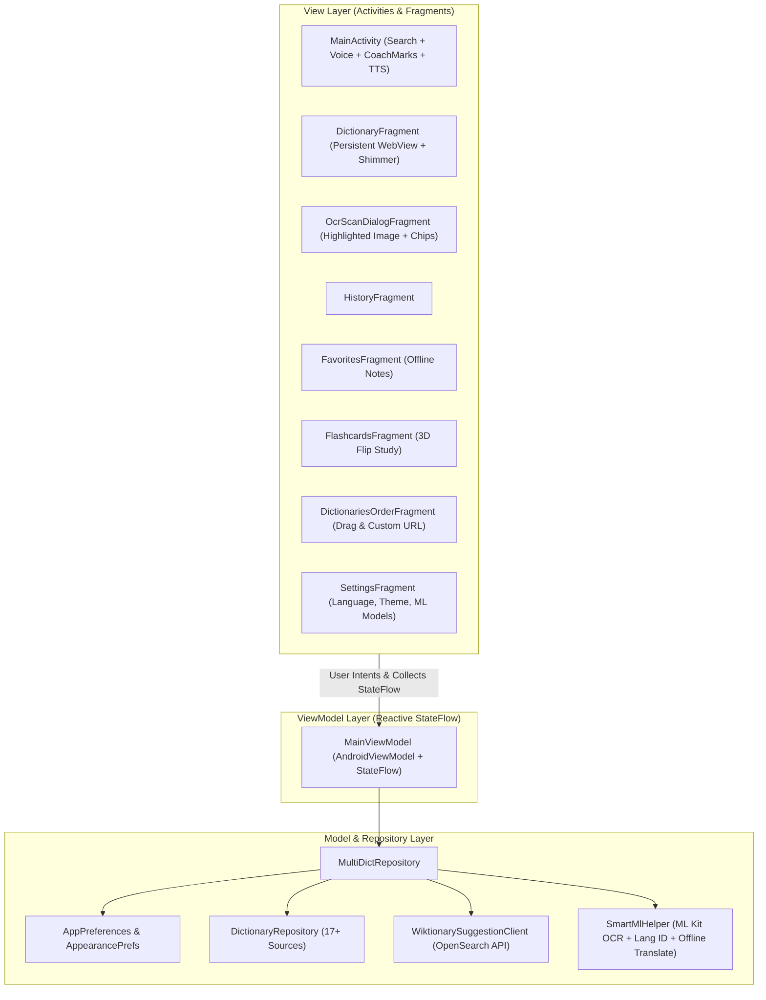

<div align="center">

# 📚 MultiDict — القاموس المتعدد للغة الألمانية
### *One Word, Every Trusted German Dictionary — With a Single Tap*
### *كلمة واحدة، وجميع القواميس الألمانية الموثوقة بضغطة واحدة*

[-3DDC84?style=for-the-badge&logo=android&logoColor=white)](#)
[](#)
[-C8372D?style=for-the-badge)](#)
[-0E7C6B?style=for-the-badge)](#)
[](#)

<br/>

**[⬇️ Download Latest APK (`MultiDict-v1.0.apk`)](https://github.com/mohamedadel452/MultiDict/releases/latest/download/MultiDict-v1.0.apk)** · **[📦 Direct Repo APK](./MultiDict-v1.0.apk)**

*Made with love by **Eng. Mohamed Adel (م. محمد عادل)** — Free, ad-free, and built to make learning German faster and calmer.*

</div>

---

## ✨ Overview | نبذة عن التطبيق

هل تعبت من فتح عشرات التبويبات والتنقل بين القواميس المختلفة أثناء دراسة اللغة الألمانية؟  
صممتُ تطبيق **MultiDict** ليجمع لك **أكثر من 17 قاموساً ألمانياً موثوقاً في مكان واحد** — تكتب الكلمة مرة واحدة فقط، وتتصفح معناها، مرادفاتها، تصريفات الأفعال، الأمثلة السياقية، الصور، والنطق الصوتي بضغطة واحدة!

**MultiDict** is a modern, scholarly Android application built for learners of the German language. Instead of opening multiple browser tabs or switching between separate dictionary apps, you type or select a German word **once** and browse definitions, synonyms, collocations, verb conjugations, real-world sentence corpora, audio pronunciations, Arabic translations, and visual imagery across **17+ authoritative dictionaries** simultaneously.

---

## 🎨 "Ink & Ivory" Design System | نظام التصميم

MultiDict is crafted around the **"Ink & Ivory"** scholarly reading-room aesthetic:
- **Warm Daylight ("Ink & Ivory")**: Soft ivory paper backgrounds (`#FAF8F5`), pure crisp cards (`#FFFFFF`), warm stone surfaces (`#F3EFEA`), and deep charcoal ink (`#1C1B19`) with a signature **Dictionary Crimson (`#C8372D`)** accent.
- **Warm Obsidian Dark Mode**: True low-glare reading surfaces (`#121210` & `#1A1917`), muted coral-red accents (`#E86A5F`), and synchronized Android WebView dark rendering (`isAlgorithmicDarkeningAllowed` / `forceDark`).
- **Editorial Typography**:
  - **Latin (EN/DE)**: *Plus Jakarta Sans* for UI clarity + *Newsreader* serif for displayed headwords.
  - **Arabic (AR)**: *Cairo* for UI & body + *Amiri* for scholarly titles, with generous line heights (`1.35x`).
- **Smart Vertical Scroll Guard**: Custom `NestedWebViewHost` direction-lock engine that locks out horizontal tab switching as soon as vertical reading/scrolling begins—preventing accidental tab swaps from natural thumb tilt.

---

## 🚀 Key Features | المميزات الرئيسية

### 1. 🔍 Instant Multi-Dictionary Lookup (17+ Built-in Sources)
All active dictionary tabs load simultaneously in memory (`ViewPager2` + persistent `DictionaryFragment` instances) so switching tabs is instantaneous:

| Category | Built-in Dictionaries |
| :--- | :--- |
| **Monolingual & Grammar** | **Duden**, **DWDS**, **Sprachwissen**, **Wiktionary** |
| **Synonyms & Collocations** | **Synonyme**, **Stilwörterbuch (DWDS Wortprofil)**, **OpenThesaurus**, **Wortschatz (Uni Leipzig)** |
| **Bilingual (DE ↔ AR / EN)** | **ArabDict**, **PONS**, **Langenscheidt**, **FreeDic** |
| **Verbs & Conjugations** | **Verben.de**, **Verbformen** |
| **Audio, Context & Visuals** | **Forvo** (Native pronunciation), **Bilder** (Google Images), **Wikipedia** |
| **Custom Dictionaries** | Add unlimited custom dictionaries using any URL template with `{q}` |

### 2. 🎙️📷 Smart Input & On-Device Machine Learning (ML Kit)
- **Live Voice Search (`DE / EN / AR`)**: Speak words or phrases with real-time partial transcription (`SpeechRecognizer`), an audio-level pulsing halo (`VoicePulseView`), and a one-tap language badge (`DE / EN / AR`) right inside the search bar.
- **Camera & Gallery OCR Scan**: Take a photo of any book, sign, or screen—or pick an image from your gallery—to run bundled on-device **ML Kit Text Recognition**. Words are highlighted on the image and presented as tappable chips (single-word or multi-word phrase mode).
- **Smart Language Detection**: Automatically identifies whether your input is German, Arabic, or English (`com.google.mlkit:language-id`), shows a dismissible *"Detected: …"* chip, and auto-switches or suggests the best matching dictionary tab.
- **Instant On-Device Translation Card**: Displays a collapsible **Quick Translation** card above the dictionary page (`com.google.mlkit:translate`) with offline model management (download/delete German, Arabic, and English packs in Settings).

### 3. ⚡ Smart Search & Text Integration
- **Live Wiktionary Autocomplete**: Debounced (`300 ms`) suggestions from the German Wiktionary OpenSearch API with bold prefix highlighting.
- **Global Text Selection (`ACTION_PROCESS_TEXT` & `ACTION_SEND`)**: Select any German word in any browser, PDF reader, or messaging app and tap **MultiDict** in the system popup menu to look it up immediately.
- **Foreground Clipboard Assistant**: Detects newly copied short German words (1–2 words, ≤ 30 chars) when opening the app and offers a non-intrusive one-tap *"Search for '<word>'?"* Snackbar.

### 4. 🔊 German Pronunciation & Study Tools
- **Native German TTS (`Locale.GERMAN`)**: One-tap pronunciation from the main toolbar or directly on Flashcards.
- **Favorites & Offline Personal Notes**: Star words to save them locally and attach personal notes or Arabic translations that work **100% offline**.
- **3D Interactive Flashcards**: Review saved words with a smooth 3D card-flip animation (`setCameraDistance` + `rotationY`), progress bar, and spaced-repetition style **"I know it"** / **"Review again"** actions.
- **Search History**: Automatically logs up to 200 searched words (deduplicated, newest first) with one-tap re-search and swipe/clear controls.

### 5. 🧭 First-Run Onboarding & Spotlight Coach Marks
- **5-Page Welcome Carousel**: Custom vector illustrations (including Voice, Camera OCR & Instant Translate), parallax transitions, and elongated pill indicators.
- **6-Step Interactive Spotlight Tour**: Highlights the Search Bar, Voice Search (`DE / EN / AR`), Camera OCR Scan, Bottom Dictionary Bar, Favorite Star, and Speaker icon with a pulsing accent ring and smart tooltip card, concluding with a live sample lookup (`"Haus"`).

### 6. 🌍 Full Localization & Customization
- **Per-App Language Selector**: Switch instantaneously between **System default**, **English**, and **العربية** (full RTL mirroring) via `AppCompatDelegate.setApplicationLocales`.
- **Theme Selector**: Choose between **System default**, **Light**, and **Dark** (with optional Android 12+ Material You Dynamic Colors) applied in `MultiDictApp` before activity creation for zero startup flash.
- **Dictionary Manager**: Reorder dictionaries via drag-and-drop (`ItemTouchHelper`), toggle visibility, or add custom `{q}` dictionary URLs.

---

## 🏗️ Architecture Overview (MVVM) | الهيكل البرمجي

MultiDict follows the **MVVM (Model – View – ViewModel)** architecture using Android Jetpack `AndroidViewModel`, reactive Kotlin `StateFlow`, and a unified `MultiDictRepository`:



### Package & Folder Structure (`com.example.multidict`)
```text
app/src/main/java/com/example/multidict/
├── MultiDictApp.kt                    # Application entry point
├── model/                             # Domain Models & Immutable UI States
│   ├── Dictionary.kt                  # Dictionary & DictionaryPalette models
│   ├── FavoriteWordItem.kt            # Favorite word + personal note model
│   ├── OcrModels.kt                   # OcrWordItem & OcrScanResult models
│   └── UiStates.kt                    # SmartMlUiState, FlashcardUiState, OcrUiState
├── data/                              # Repository & Data Sources
│   ├── MultiDictRepository.kt         # Unified MVVM Repository
│   ├── DictionaryRepository.kt        # Built-in 17+ dictionary catalog & badge renderer
│   ├── AppPreferences.kt              # Local SharedPreferences data source
│   ├── AppearancePrefs.kt             # Theme & per-app locale persistence
│   ├── OnboardingPrefs.kt             # Onboarding & coach-mark persistence
│   ├── WiktionarySuggestionClient.kt  # Remote OpenSearch autocomplete client
│   └── SmartMlHelper.kt               # On-device ML Kit OCR, Language ID & Translation
├── viewmodel/                         # ViewModels
│   └── MainViewModel.kt               # Shared AndroidViewModel with reactive StateFlows
└── ui/                                # Views (Activities, Fragments, Adapters, Custom Views)
    ├── MainActivity.kt
    ├── AboutActivity.kt
    ├── OnboardingActivity.kt
    ├── DictionaryFragment.kt
    ├── DictionariesOrderFragment.kt
    ├── FavoritesFragment.kt
    ├── FlashcardsFragment.kt
    ├── HistoryFragment.kt
    ├── OcrScanDialogFragment.kt
    ├── SettingsFragment.kt
    ├── adapter/
    │   ├── DictionaryAdapter.kt
    │   ├── DictionaryPagerAdapter.kt
    │   ├── OnboardingAdapter.kt
    │   └── SuggestionAdapter.kt
    └── widget/
        ├── CoachMarkOverlay.kt
        ├── NestedWebViewHost.kt
        ├── OcrHighlightOverlayView.kt
        └── VoicePulseView.kt
```

---

## 📦 Installation & Building | التثبيت وطريقة التشغيل

### Option A: Direct APK Installation (Recommended for Users)
Download and install **[MultiDict-v1.0.apk](./MultiDict-v1.0.apk)** directly on any Android device running **Android 7.0 (API 24)** or higher.

### Option B: Build from Source in Android Studio
1. Clone this repository:
   ```bash
   git clone https://github.com/mohamedadel452/MultiDict.git
   cd MultiDict
   ```
2. Open the project in **Android Studio** and wait for Gradle Sync to finish.
3. Run on an emulator or physical device, or build via CLI:
   ```powershell
   # Build Debug APK
   ./gradlew assembleDebug

   # Build Signed Release APK
   ./gradlew assembleRelease
   ```

---

## 💝 Author & Dedication | إهداء

> **Made with love by Eng. Mohamed Adel (م. محمد عادل)**  
> *"I built this app to help people who are learning languages. MultiDict is completely free, with no ads and no tracking. If you find it useful, please remember me and my parents in your prayers."*  
>  
> **صُنع بكل حب بواسطة م. محمد عادل**  
> *"صنعتُ هذا التطبيق لمساعدة كل من يتعلّم اللغات. هذا التطبيق مجاني بالكامل، بلا إعلانات وبلا تتبّع. إن انتفعت به، فلا تنسني ووالديّ من صالح دعائك."*
